<p align="center">
  
</p>

<div align="center">

[](#-the-epilogue--what-happened-next)
[](https://nextjs.org/)
[](https://react.dev/)
[](https://www.typescriptlang.org/)
[](https://tailwindcss.com/)
[](https://nodejs.org/)
[](LICENSE)

<br>

*A shelf is just a promise kept in rows,*<br>
*a quiet door to everything one knows.*<br>
*Before a single brick was laid, someone sat down to draw*<br>
*the reading room, exactly as they saw.*

<br>

</div>

This is where [OpenShelves](https://github.com/openshelves-labs/openshelves) started: a clickable prototype of a university library, built before a single line of backend existed. Fourteen screens, one student, one librarian, and a library that never closes. It runs entirely in the browser on typed sample data, and every screen you see below shaped what the real product is now becoming.

> [!WARNING]
> **Archived.** This prototype is finished and read-only. It isn't maintained, isn't supported, and isn't the OpenShelves product.
> The real thing is being built in **[openshelves-labs/openshelves](https://github.com/openshelves-labs/openshelves)**.

<p align="center"></p>

## 🎬 The Premise · Meet the reader

<div align="center">

*It is always Thursday here, and always late October;*<br>
*the leaves never land, and nothing is ever overdue for long.*

</div>

<br>

**Aditya Menon** studies Computer Science at **Central University Library**. It is Thursday, 24 October 2024, and it always will be: the demo's clock is pinned so every due date and countdown looks exactly as designed.

Aditya has three books out, one hold waiting at the desk, a reading list for a seminar, and a $14.50 fine he'd rather not think about. Follow him through the library.

| 🖱️ Everything is clickable | 🧠 Nothing is saved | 🔌 No backend |
|---|---|---|
| Renew a loan, place a hold, start a reading list, mark notifications read. It all works. | State lives in memory, so a reload puts every book back on its shelf. | Pages ask a small data layer for books and loans. Today it answers from mock data, tomorrow from the real API. |

<p align="center"></p>

## 🚪 Chapter 1 · Arriving

<div align="center">

*The door swings open, and it already knows your name.*

</div>

<br>

Sign in with the campus account, and the library greets you by name: what's due, what's waiting, and where you left off.

<p align="center">
  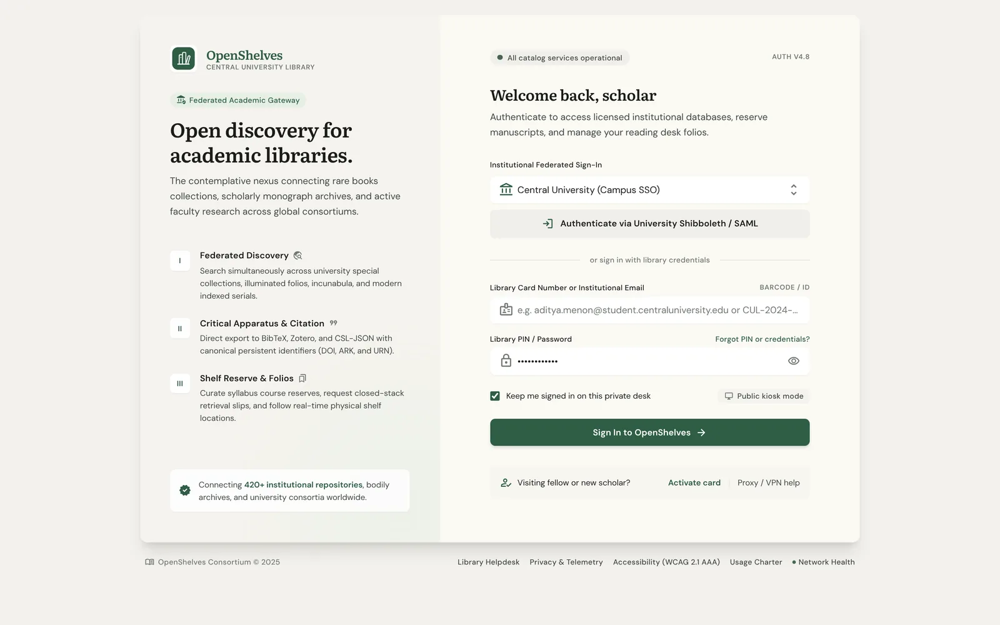
  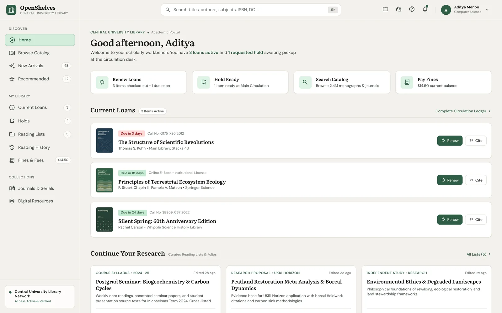
</p>

<p align="center"></p>

## 🔎 Chapter 2 · Finding

<div align="center">

*Ask the shelves a question.*<br>
*Somewhere in the stacks, a spine leans out to answer.*

</div>

<br>

One search across books, journals and databases, with filters on the right so the results stay centre stage. Open a book and everything is there: where it sits on the shelf, how many copies are free, and a one-click hold.

<p align="center">
  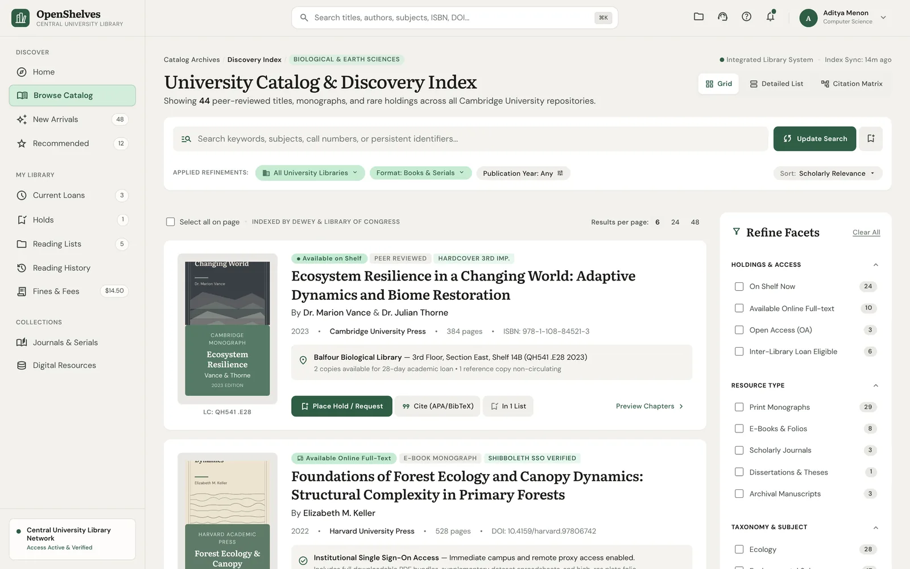
  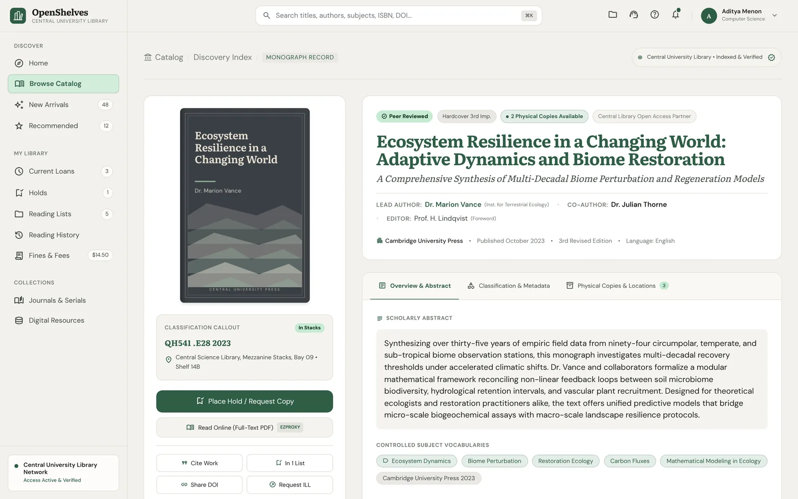
</p>

Fresh arrivals, journal subscriptions and digital databases each get a room of their own.

<p align="center">
  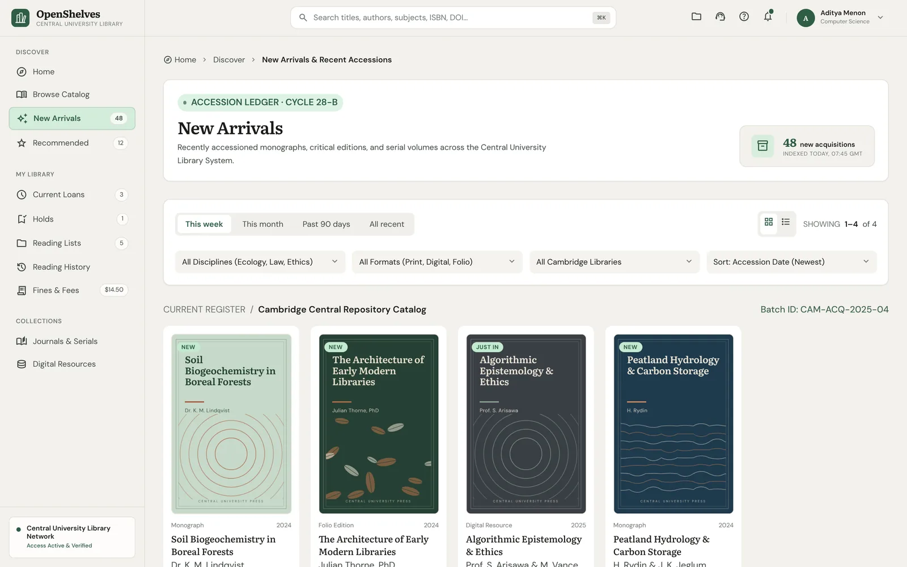
  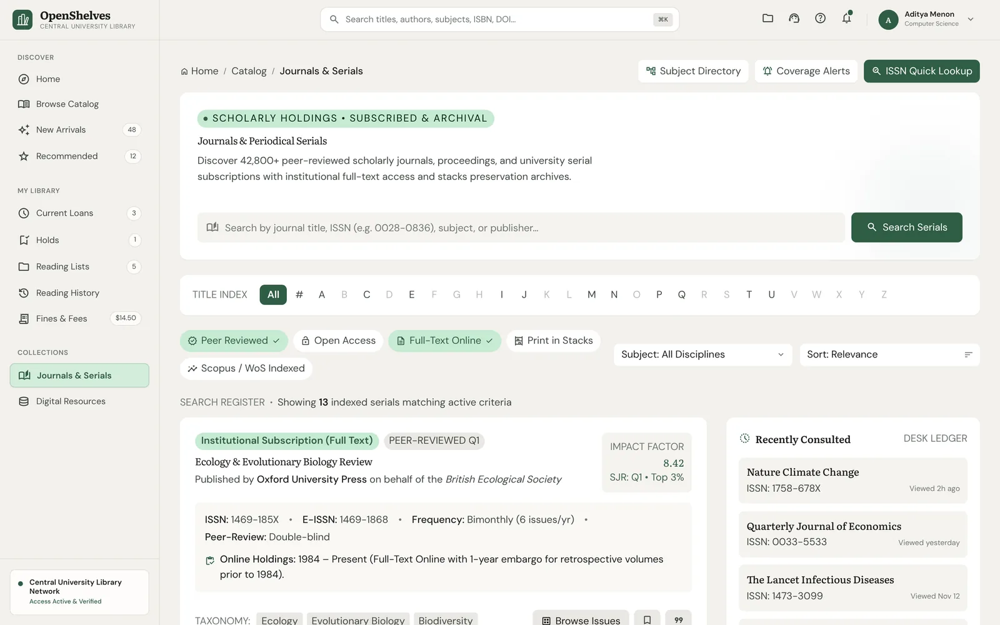
  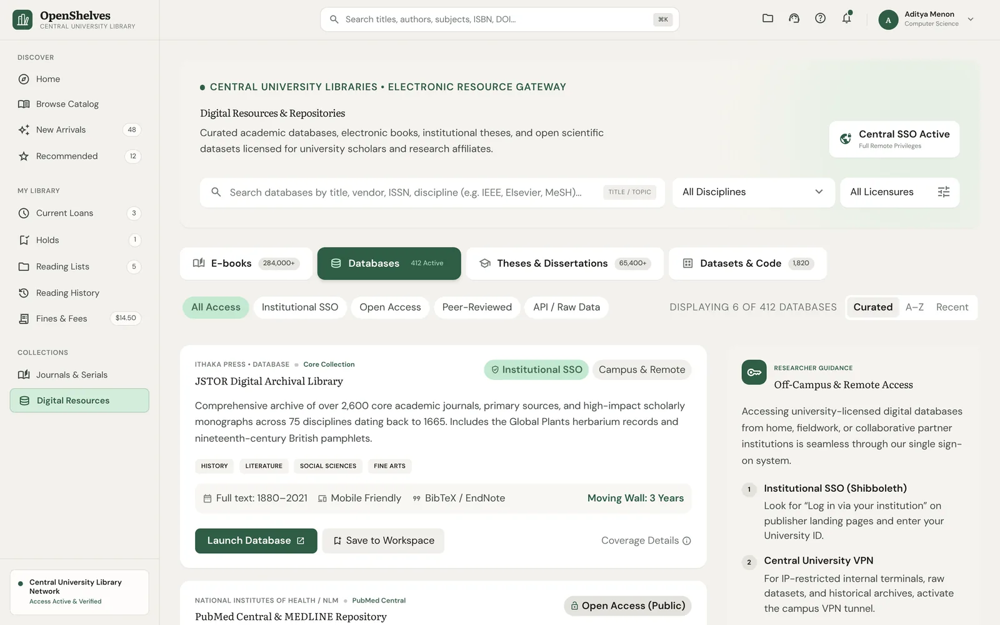
</p>

<p align="center"></p>

## 🔄 Chapter 3 · Borrowing

<div align="center">

*Take it home a while. Read it by lamplight.*<br>
*The library will keep your place in line.*

</div>

<br>

Every loan, its due date and how many renewals are left, with *Renew all eligible* one click away. Fines are itemised, explained and payable in the same place, no trip to the circulation desk.

<p align="center">
  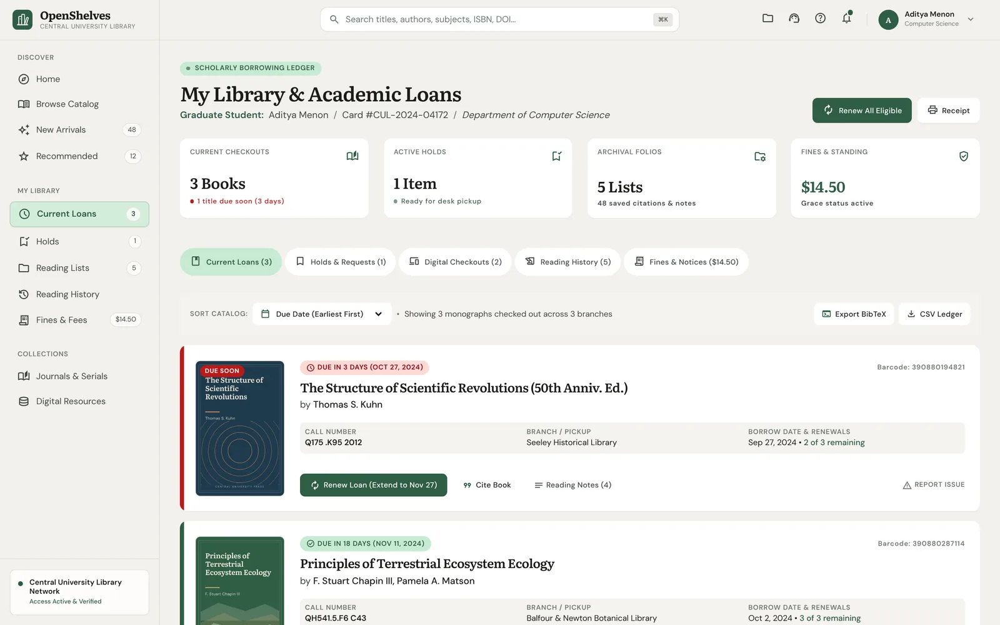
  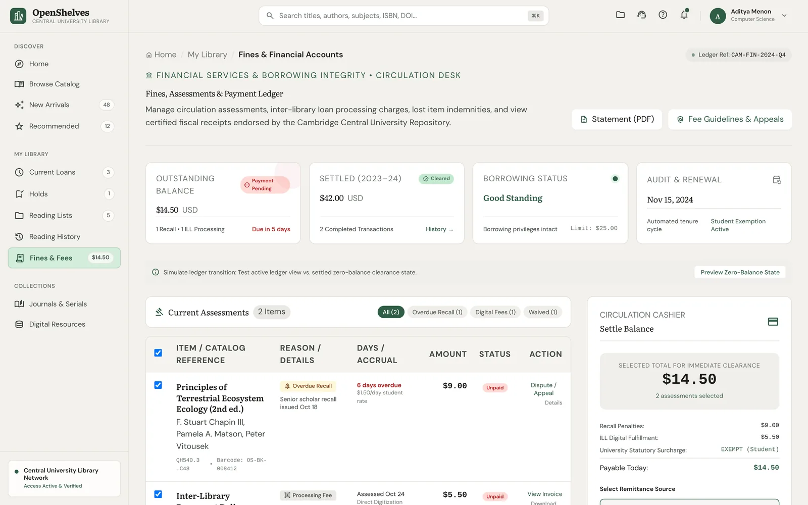
</p>

<p align="center"></p>

## 🗃️ Chapter 4 · Researching

<div align="center">

*Every footnote is a footprint*<br>
*someone left for you to follow.*

</div>

<br>

Reading lists turn into research folios: course syllabi, thesis sources, group projects. Every item can be cited in APA, MLA, Chicago or BibTeX, and your reading history remembers everything you've ever borrowed.

<p align="center">
  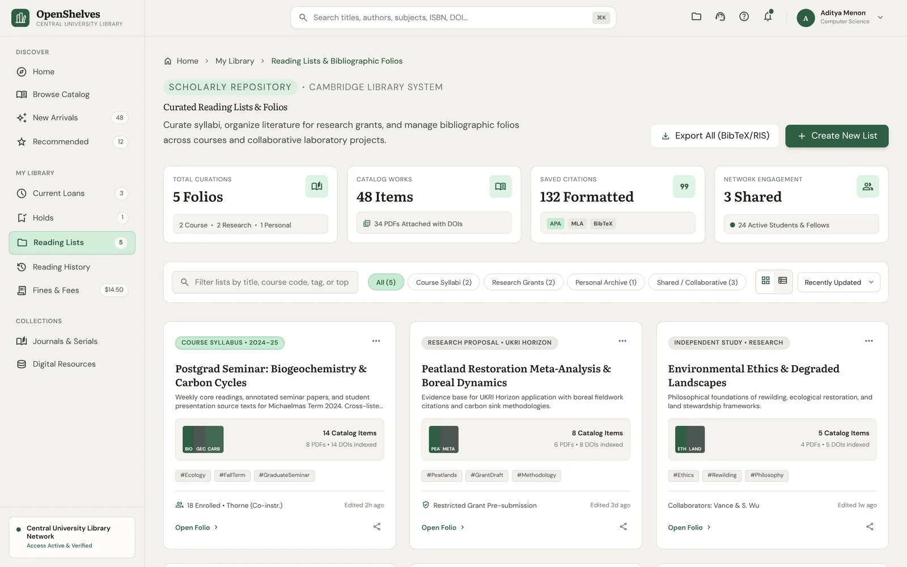
  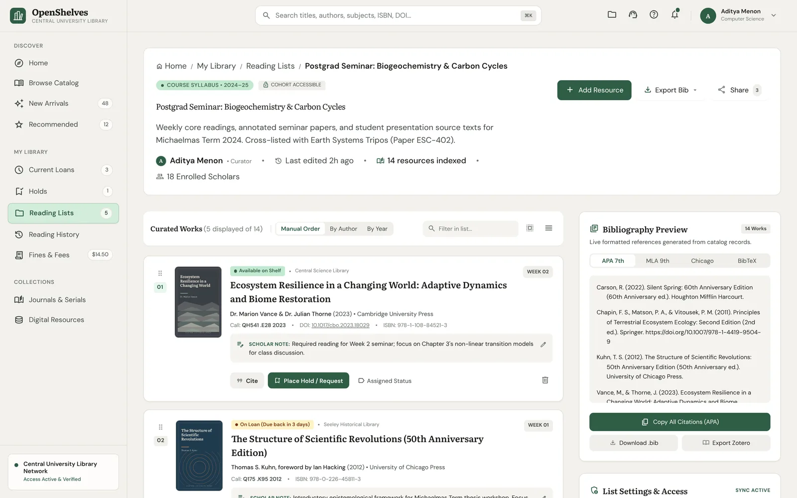
</p>

<p align="center">
  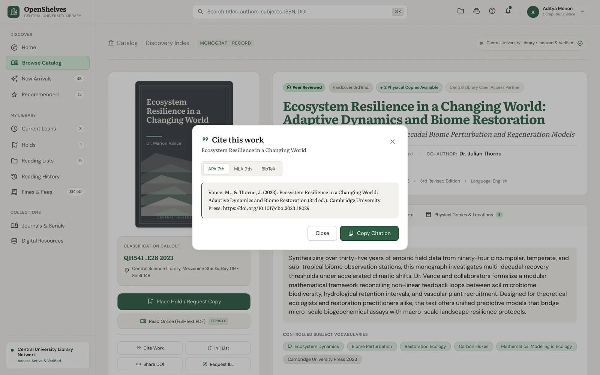
  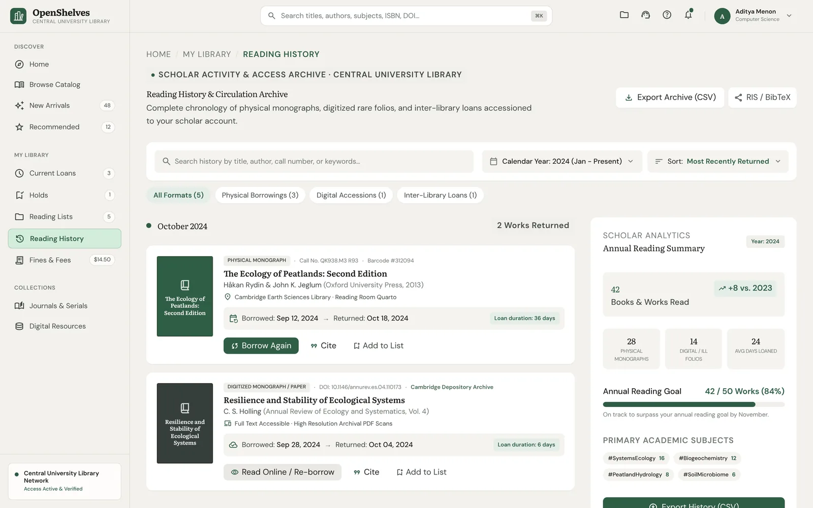
</p>

<p align="center"></p>

## 💬 Chapter 5 · Asking for help

<div align="center">

*And if you're lost between the stacks,*<br>
*a quiet voice says: over here.*

</div>

<br>

The bell tells you when a hold is ready or a loan is due. And when you're stuck, *Ask a Librarian* opens a chat that any librarian on duty can answer.

<p align="center">
  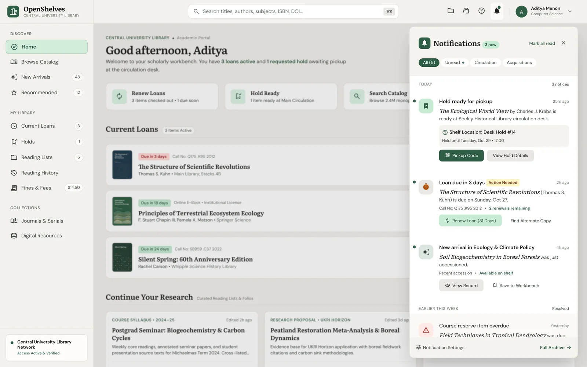
  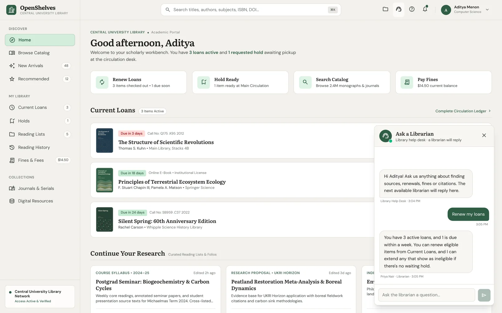
</p>

<p align="center"></p>

## 🛠️ Behind the Desk · The librarian's view

<div align="center">

*Every book that finds its reader*<br>
*was first found by a librarian.*

</div>

<br>

Adding a book shouldn't mean typing it in. Enter an ISBN, and the catalog asks Open Library, Google Books and others, shows their matches side by side, and lets the librarian pick the best record.

<p align="center">
  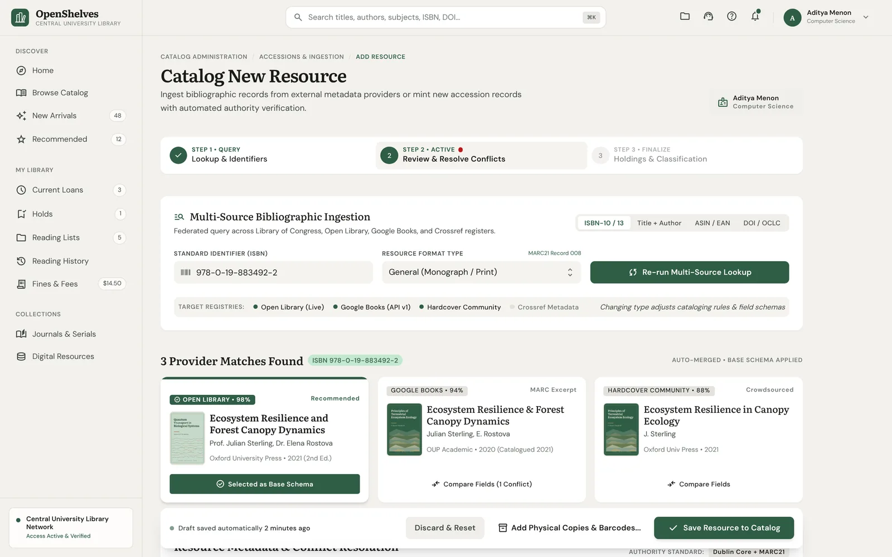
</p>

<p align="center"></p>

## 🗺️ The Map · Every screen

| | Screen | Route |
|---|---|---|
| 🔐 | Sign in | `/sign-in` |
| 🏠 | Home: current loans, holds, new arrivals, reading lists | `/` |
| 🔎 | Catalog search and book detail | `/catalog`, `/catalog/[id]` |
| ✨ | New arrivals | `/new-arrivals` |
| 📰 | Journals | `/journals` |
| 💾 | Digital resources | `/digital-resources` |
| 🔄 | Loans | `/loans` |
| 💳 | Fines | `/fines` |
| 🗃️ | Reading lists | `/lists`, `/lists/[id]` |
| 🕰️ | Reading history | `/history` |
| 👤 | Profile | `/profile` |
| 🛠️ | Librarian: add a resource | `/admin/add-resource` |

## 🏗️ The Blueprint · How it's built

A plain Next.js app with one rule: pages never touch the mock data directly.

```text
app/          Routes. Groups decide the frame: (library) and (admin) get the shell, (auth) doesn't
components/   Shared UI, plus one folder per screen
lib/api/      The data layer: async functions shaped like future REST calls
lib/store     In-memory state for loans, holds, lists and notifications
mock/         Typed sample data: books, loans, fines, journals, users
types/        The shared domain model
```

| Layer | Stack |
|---|---|
| 🖥️ Framework | Next.js 16 (App Router) · React 19 · TypeScript (strict) |
| 🎨 Styling | Tailwind CSS 3 · Literata and DM Sans · Material Symbols |
| 🗄️ Data | Typed mock data behind `lib/api`, no backend |

The design decisions behind every screen are written down in [docs/DESIGN-DECISIONS.md](docs/DESIGN-DECISIONS.md).

<p align="center"></p>

## 🚀 Try It · Running it locally

You'll need **Node.js 26** or newer.

```bash
git clone https://github.com/openshelves-labs/openshelves-demo-site.git
cd openshelves-demo-site
npm install
npm run dev   # http://localhost:3000
```

Start at `/sign-in`, or walk straight in through the front door as Aditya.

<p align="center"></p>

## 📜 The Epilogue · What happened next

<div align="center">

*The ink has dried. The drawing did its work.*<br>
*Across the street, the building has begun.*

</div>

<br>

The sketch did its job. Its screens became the [API design](https://github.com/openshelves-labs/openshelves/blob/main/docs/api-design/README.md), and they're now being rebuilt, properly this time, as the main repository's [web app](https://github.com/openshelves-labs/openshelves/tree/main/frontend), backed by a real Spring Boot API and PostgreSQL.

## 🤝 An Open Invitation · Contributing

This repository is archived, so it doesn't accept issues or pull requests. Ideas and fixes are very welcome in the [main repository](https://github.com/openshelves-labs/openshelves); start with its [contributing guide](https://github.com/openshelves-labs/openshelves/blob/main/CONTRIBUTING.md).

## 📄 House Rules · License

This demo is part of the Licensed Work "OpenShelves" and is licensed under the same terms as the main repository: the **Business Source License 1.1**. See [LICENSE](LICENSE).

Use of the "OpenShelves" name and logo is governed by the [OpenShelves Anti-Impersonation Policy](https://github.com/openshelves-labs/openshelves/blob/main/ANTI-IMPERSONATION.md).

<p align="center"></p>

<div align="center">

*Every library starts as a sketch. This was ours.*

</div>
