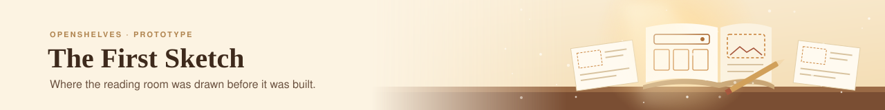

<p align="center">
  
</p>

> [!WARNING]
> **Archived.** This prototype is finished and read-only. It isn't maintained, isn't supported, and isn't the OpenShelves product.
> The real thing is being built in **[openshelves-labs/openshelves](https://github.com/openshelves-labs/openshelves)**.

*Before the library was built, someone drew the reading room.*

This is where [OpenShelves](https://github.com/openshelves-labs/openshelves) started: a clickable prototype that showed what searching, borrowing and managing a reading list could feel like, before any of it was real. It runs entirely in the browser on typed sample data, with no backend behind it.

Its screens shaped the [API design](https://github.com/openshelves-labs/openshelves/blob/main/docs/api-design/README.md) and are now being rebuilt, properly this time, in the main repository's [web app](https://github.com/openshelves-labs/openshelves/tree/main/frontend).

---

## 🗺️ What's inside

| | Screen | Route |
|---|---|---|
| 🏠 | Home: loans due, holds, recommendations | `/` |
| 🔐 | Sign in | `/sign-in` |
| 🔎 | Catalog search and book detail | `/catalog`, `/catalog/[id]` |
| ✨ | New arrivals | `/new-arrivals` |
| 💾 | Digital resources | `/digital-resources` |
| 📰 | Journals | `/journals` |
| 🔄 | Loans | `/loans` |
| 🗃️ | Reading lists | `/lists`, `/lists/[id]` |
| 🕰️ | Reading history | `/history` |
| 💳 | Fines | `/fines` |
| 👤 | Profile | `/profile` |
| 🛠️ | Librarian: add a resource | `/admin/add-resource` |

The decisions behind the design are in [docs/DESIGN-DECISIONS.md](docs/DESIGN-DECISIONS.md).

---

## 🚀 Running it locally

You'll need **Node.js 26** or newer.

```bash
git clone https://github.com/openshelves-labs/openshelves-demo-site.git
cd openshelves-demo-site
npm install
npm run dev   # http://localhost:3000
```

Everything is mock data, and "today" is fixed in [`lib/dates.ts`](lib/dates.ts), so due dates and "2 days left" labels always look the same.

---

## 🤝 Contributing

This repository is archived, so it doesn't accept issues or pull requests. Ideas and fixes are very welcome in the [main repository](https://github.com/openshelves-labs/openshelves); start with its [contributing guide](https://github.com/openshelves-labs/openshelves/blob/main/CONTRIBUTING.md).

## 📄 License

This demo is part of the Licensed Work "OpenShelves" and is licensed under the same terms as the main repository: the **Business Source License 1.1**. See [LICENSE](LICENSE).

Use of the "OpenShelves" name and logo is governed by the [OpenShelves Anti-Impersonation Policy](https://github.com/openshelves-labs/openshelves/blob/main/ANTI-IMPERSONATION.md).

---

<div align="center">

*Every library starts as a sketch. This was ours.*

</div>
